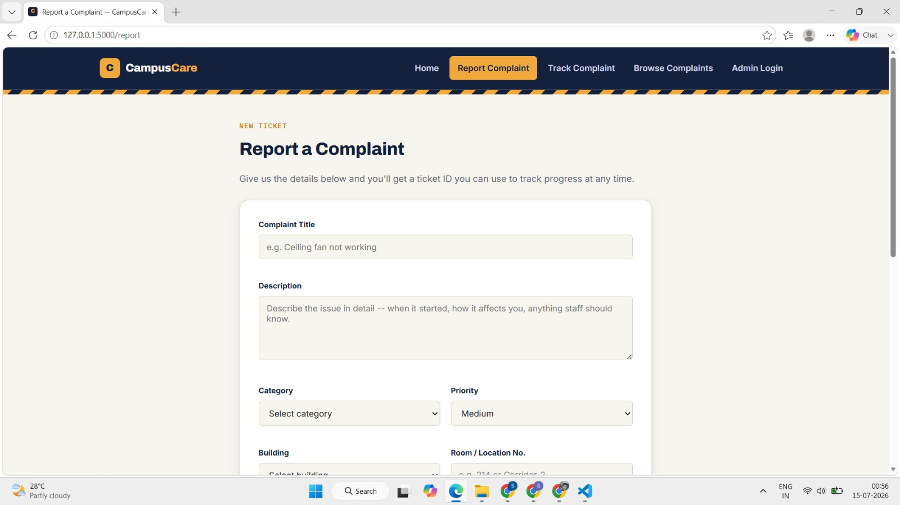
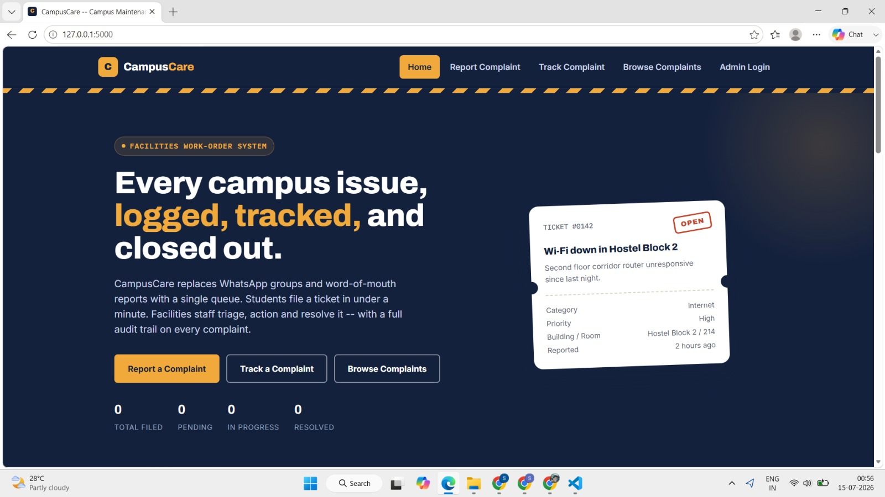
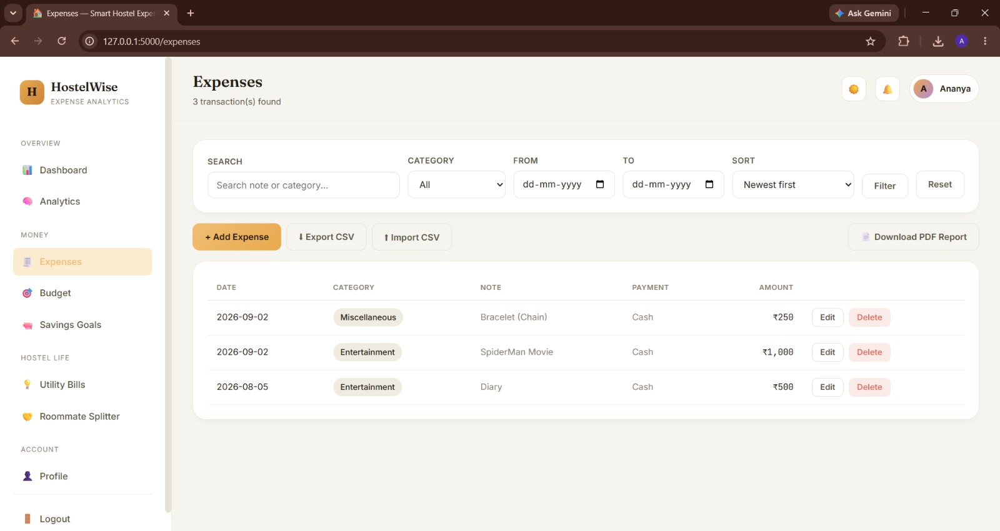
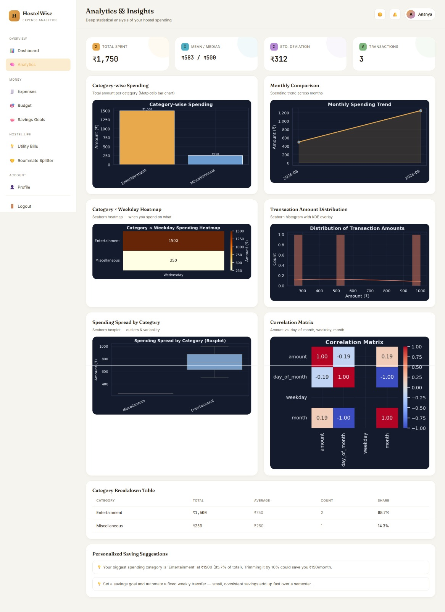

# 🏆 Hack-o-Week: Full-Stack Development & Applied Machine Learning (Odd Sem)

[](#)
[](#)
[](#)
[](#)
[](#)
[](https://github.com/Salimansari369)

This repository contains the complete portfolio of coursework, engineering challenges, full-stack applications, and machine learning labs completed as part of the **Hack-o-Week (5th Semester)** curriculum. 

The projects span production-style RESTful microservices, campus utilities, numerical computing, classical supervised machine learning benchmarks, feature engineering pipelines, and unsupervised clustering algorithms.

---

## 📚 Curriculum & Tasks Overview

| Phase / Task | Project / Module Name | Focus Area | Tech Stack & Key Concepts |
|---|---|---|---|
| **Task 1** | **[CampusCare](./task%201)** | Full-Stack REST API & Web App | Flask, SQLite, Jinja2, RESTful Routing, Auth, Complaint Lifecycles |
| **Task 2** | **[HostelWise](./task%202)** | Room Allocation & Data Science | Python, Pandas, Data Cleaning, Aggregations & Exploratory Analysis |
| **Task 3** | **[Linear Algebra & Calculus](./task%203)** | Mathematical Foundations for ML | NumPy, Matrix Decompositions, Eigenvalues, Gradient Computations |
| **Task 4** | **ML: Regression & Classification** | Supervised Model Benchmarking | Scikit-Learn, Linear/Ridge/Lasso, Decision Trees, SVM, Random Forests |
| **Task 5 (Part 1)** | **Model Evaluation & Feature Engineering** | Preprocessing & Metrics Tuning | Imputation, One-Hot/Label Encoding, Scalers, Cross-Validation, ROC-AUC |
| **Task 5 (Part 2)** | **Clustering Complete Workflow** | Unsupervised Machine Learning | K-Means, Elbow Method, Silhouette Analysis, PCA Visualizations |
| **Task 6** | **[PCA & t-SNE](./task_6_week_11,12_PCA_and_tSNE.ipynb)** | Dimensionality Reduction & Manifold Learning | PCA, Scree Plot, Explained Variance, t-SNE Perplexity & 2D/3D Projection |
| **Task 7** | **[Ensemble Methods & Regularization](./task_7_week_13,14_Ensemble_Methods.ipynb)** | Advanced Ensembles & Generalization | Bagging, Random Forest, AdaBoost, Gradient Boosting, XGBoost, LightGBM, L1/L2 Regularization, Bias-Variance Trade-off |
| **Task 8** | **[Neural Networks & Deployment](./task_8_week_15,16_Neural_Networks.ipynb)** | Deep Learning Foundations & Model Serialization | Perceptrons, Activation Functions (Sigmoid, ReLU, Tanh), Forward/Backprop from scratch (NumPy), Loss Functions, Optimizers (SGD, Adam), Pickle/Joblib Deployment |

---

## 🔍 Detailed Task Highlights

### 1. 🛠️ Task 1: CampusCare (Campus Maintenance & Complaint Management)
* A production-style **Flask REST API** with an administrative web console.
* Allows campus students and staff to register, track, prioritize, and resolve infrastructure issues (electrical, plumbing, Wi-Fi, equipment breakdown).
* Clean separation of API endpoints and UI controllers.

### 2. 🏢 Task 2: HostelWise & Data Science Foundations
* Hostel room allocation logic and campus accommodation management.
* Exploratory Data Analysis (EDA) notebook (`python_datascience_practice.ipynb`) covering data manipulation, filtering, and statistical summaries using Pandas and NumPy.

### 3. 📐 Task 3: Linear Algebra & Calculus for Machine Learning
* Computational implementations of vector spaces, matrix transformations, eigenvalues/eigenvectors, and partial derivatives essential for deep learning and loss optimization.

### 4. 🤖 Task 4: Supervised ML Benchmarking
* Comparative evaluation between multiple regression models (Linear, Polynomial, Regularized) and classification algorithms (Logistic Regression, Decision Trees, Ensemble Random Forest, Support Vector Machines).
* Metrics: $R^2$, RMSE, MAE, Confusion Matrix, Precision, Recall, F1-Score.

### 5. 🔬 Task 5: Feature Engineering & Unsupervised Clustering
* **Part A:** Robust pipelines for outlier detection, missing value imputation, variance thresholding, and hyperparameter search.
* **Part B:** End-to-end unsupervised clustering using K-Means, optimal cluster selection ($K$) via Elbow and Silhouette scores, and dimensionality reduction via Principal Component Analysis (PCA).

### 6. 🌐 Task 6: Dimensionality Reduction (PCA & t-SNE)
* Mathematical formulation and implementation of Principal Component Analysis (covariance matrix decomposition, eigenvalues, cumulative explained variance).
* Non-linear manifold learning with t-SNE exploring varying perplexity and learning rate dynamics for high-dimensional visual separation.

### 7. 🌲 Task 7: Ensemble Methods, Bias-Variance Trade-off & Regularization
* Empirical measurement of Bias² and Variance, diagnosis of overfitting vs underfitting through learning curves and decision boundary visualizations.
* Comparative regularization benchmarks: unregularized high-degree polynomials vs L1 (Lasso) and L2 (Ridge) across penalty strengths ($\alpha$).
* Comprehensive ensemble architectures: Bagging, Random Forests, Boosting (AdaBoost, Gradient Boosting, XGBoost, LightGBM), and Voting/Stacking classifiers.

### 8. 🧠 Task 8: Neural Networks from Scratch & Model Deployment
* **Model Serialization & Deployment:** Production artifact persistence and deserialization patterns using `pickle` and `joblib`.
* **Deep Learning Mathematics:** Step-by-step mathematical derivation and implementation of single-layer Perceptrons, activation functions (Sigmoid, Tanh, ReLU, LeakyReLU, Softmax), and gradient backpropagation.
* **Loss Landscapes & Optimizers:** Comparative analysis between MSE and Cross-Entropy losses, alongside optimization convergence with Gradient Descent, Momentum, and Adam.
* **From-Scratch NumPy Architecture:** Full multilayer feedforward neural network coded purely in NumPy with trainable dense layers, forward pass, backpropagation, model weight saving, and inference reloading.

---

## 📸 Application Screenshots & Model Visualizations

<table>
  <tr>
    <td width="50%" valign="top">
      <h3 align="center">🛠️ Task 1: CampusCare Complaint Management</h3>
      <p align="center">
        
      </p>
      <p align="center"><em>Real-time campus maintenance request submission and category routing portal.</em></p>
    </td>
    <td width="50%" valign="top">
      <h3 align="center">📊 Task 1: Resolution Tracking & Status Registry</h3>
      <p align="center">
        
      </p>
      <p align="center"><em>Administrative dashboard monitoring ticket states, priority queues, and technician assignments.</em></p>
    </td>
  </tr>
  <tr>
    <td width="50%" valign="top">
      <h3 align="center">🏢 Task 2: HostelWise Data Science & EDA</h3>
      <p align="center">
        
      </p>
      <p align="center"><em>Pandas/NumPy statistical analysis on student room allocations and occupancy rates.</em></p>
    </td>
    <td width="50%" valign="top">
      <h3 align="center">📈 Task 2: Data Cleaning & Aggregation Summary</h3>
      <p align="center">
        
      </p>
      <p align="center"><em>Feature summaries, outlier boundaries, and room distribution statistics.</em></p>
    </td>
  </tr>
</table>

---

## 🚀 Setup & Execution Guide

### 1. Clone the Repository
```bash
git clone https://github.com/Salimansari369/Hack-o-Week-odd-5sem-2026-2027.git
cd Hack-o-Week-odd-5sem-2026-2027
```

### 2. Running Jupyter Notebooks (Tasks 2, 3, 4, 5)
```bash
python -m venv venv
# On Windows:
venv\Scripts\activate

pip install -r "task 1/requirements.txt" jupyter scikit-learn matplotlib seaborn
jupyter notebook
```

### 3. Running CampusCare (Task 1)
```bash
cd "task 1"
python run.py
```
Open `http://localhost:5000` in your web browser.

---

## 👤 Author

* **Salim Ansari**
  * GitHub: [@Salimansari369](https://github.com/Salimansari369)
